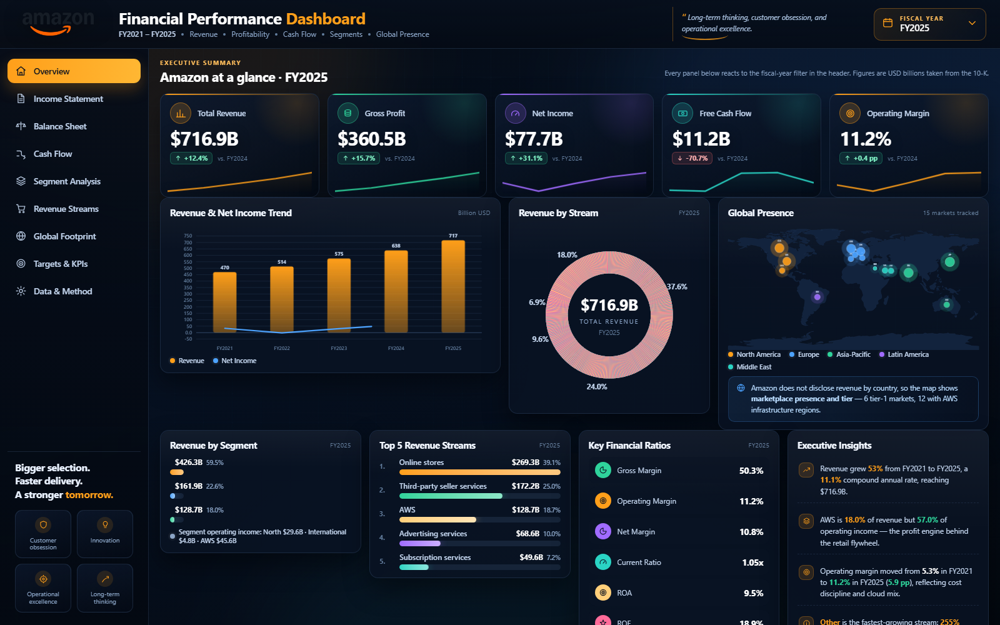
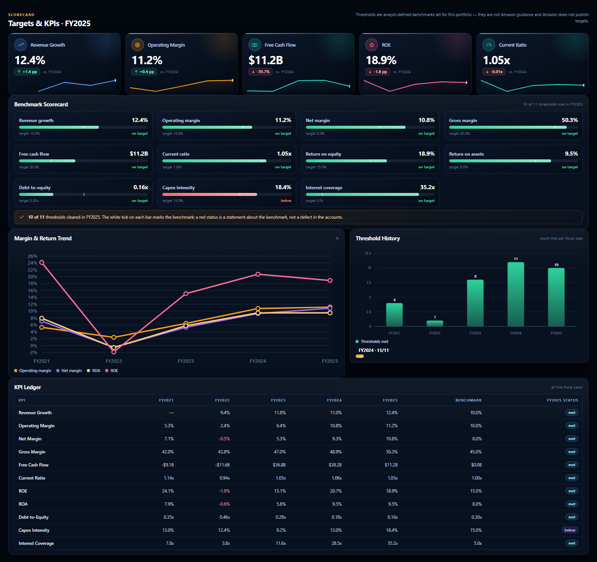

# Amazon Financial Atlas

Five fiscal years of Amazon's audited financials, built twice from one corrected dataset: a **Power BI (PBIP) report** with a star schema and 172 DAX measures, and a **single-file HTML atlas** that runs in any browser with no server and no dependencies. Both carry the same nine analysis pages, the same dark executive theme, and the same numbers.



## Overview

| Item | Detail |
|---|---|
| Period | FY2021 - FY2025 (Amazon's fiscal year is the calendar year) |
| Coverage | 3 reportable segments, 7 revenue streams, 15 markets across 5 regions |
| Tooling | Power BI Desktop (PBIP / PBIR + TMDL), DAX, HTML / CSS / vanilla JS |
| Model | Star schema: 5 fact tables, 9 dimensions, 1 design table, 172 measures, 10 relationships |
| Filters | Fiscal year, region, segment, revenue stream, source sheet |
| Page size | Power BI: 1920 x 1250 custom canvas, 8 pages, 663 visuals - HTML: 9 responsive pages |
| Headline | Revenue $469.8B to $716.9B (11.1% CAGR), operating margin 5.3% to 11.2% |

## What the report includes

- **Overview** - five KPI cards, revenue and net income trend, revenue mix donut, presence map, key ratios, executive insights.
- **Income Statement** - line-by-line build from net sales to net income, with margin walk and expense mix.
- **Balance Sheet** - assets, liabilities and equity across five years, liquidity and capital structure.
- **Cash Flow** - operating cash flow, capex and free cash flow, with the FCF margin that fell back to 1.6% in FY2025.
- **Segment Analysis** - North America, International and AWS, including the fact that AWS is 18.0% of revenue but 57.0% of operating income.
- **Revenue Streams** - online stores, third-party seller services, AWS, advertising, subscriptions, physical stores and other.
- **Global Footprint** - 15 markets by region, tier and AWS presence, on a map plus a full register.
- **Targets & KPIs** - eleven analyst benchmarks with gauge, threshold history and a five-year KPI ledger.
- **Data & Method** - the audit trail: every workbook figure that disagreed with the 10-K, and what was used instead.



## Design

A `#060D1A` navy canvas with the Amazon logo palette: `#FF9F1A` orange as the single accent, plus `#4DA3FF`, `#2FD39B`, `#A06BFF` and `#2AD4C4` to separate series. A left icon rail carries the page navigation, the top bar holds the wordmark and the fiscal-year filter, and every KPI card pairs a value with a delta chip and a five-point sparkline. The backdrop is painted from the palette (gradient, ring glows, faint grid) at the report's exact canvas ratio, so nothing is stretched and no reference screenshot leaks into the build.

## The data audit

The starting workbook was wrong in **68 places** against Amazon's filed 10-K, and the errors were not rounding. The largest single gap:

```text
Revenue Mix - Physical Stores - FY2021
workbook      172,000  ($M)
10-K audit     17,075  ($M)
delta        -154,925  ($M)   a 10x slip on one line item
```

Every figure in both builds comes from the audited set, and the Data & Method page lists all 68 corrections with sheet, metric, year, workbook value, audited value and delta - so the numbers can be checked rather than trusted.

## The technical challenge

Two things cost the most time.

**1. Power BI would not bind the star schema.** The report is generated as PBIP (PBIR + TMDL) rather than hand-dragged. With the relationships written inline in `model.tmdl`, Desktop opened the report but left every visual unbound:

```text
definition/model.tmdl              + relationships inline   visuals stay blank
definition/model.tmdl              separate schema
definition/relationships.tmdl      own file                 schema binds, 285 fields resolve
```

**2. A ratio unit bug that looked like a real number.** Ratios are stored as fractions, and the display layer multiplied every one of them by 100. Margins came out right, but the multiples did not:

```text
Current ratio      105.08x  ->  1.05x
Interest coverage  3,516.9x ->  35.2x
```

The fix separated *stored as a fraction* from *shown as a percent*: only `%` metrics scale by 100, `x` metrics keep their value. That also had to move with it - the delta chips now read percentage points for margins and absolute multiples (`-0.01x`) for ratios, and the benchmark gauges plot the same unit as their target line. A number that is 100x off still looks plausible in a dashboard; this is why the audit page ships with the report.

## DAX and report engineering

- Every card reads a `Latest ...` measure anchored on `MAX ( Dim_Year[Year] )`, so an unfiltered page shows FY2025 and not a five-year sum.
- Delta chips return `n/m` when the prior year is negative or missing, and `—` for FY2021, instead of a misleading percentage.
- `REMOVEFILTERS ( Dim_Year )` keeps the five-year trends intact while the rest of the page follows the selected year.
- The globe and the market register answer on presence, tier and AWS regions only - Amazon reports net sales by segment, never by country, so no country revenue is implied anywhere.
- The 3D globe on the Global Footprint page is the Three.js custom visual built for an earlier Apple Revenue Atlas report, registered in this project's `CustomVisuals` folder as `appleGlobe` and driven entirely by this project's market data.
- The HTML atlas builds its own SVG charts (bars, lines, donut, waterfall, gauges, sparklines, equirectangular map) with no chart library, so the file stays a single portable document.

## Repository contents

```text
amazon-financial-atlas/
|-- html/Amazon_Financial_Atlas_FY2021_FY2025.html    # single-file interactive atlas
|-- pdf/Amazon_Financial_Atlas_FY2021_FY2025.pdf      # nine-sheet print export
|-- powerbi/
|   |-- Amazon_Financial_Atlas.pbip                   # open this in Power BI Desktop
|   |-- AmazonAtlas.Report/                           # PBIR report, 8 pages, custom theme
|   |-- AmazonAtlas.SemanticModel/                    # TMDL star schema and measures
|   `-- README.txt                                    # build notes (Arabic)
|-- data/
|   |-- Amazon_Financial_Analysis_FINAL_v2.xlsx       # source workbook used for the audit
|   |-- Amazon_Fact_Financials.csv                    # model fact tables as CSV
|   |-- Amazon_Fact_Segments.csv
|   |-- Amazon_Fact_RevenueMix.csv
|   `-- Amazon_Data_Audit_20_Largest.csv              # 20 largest corrections
`-- assets/                                           # screenshots and the wordmark
```

## How to open

1. **HTML atlas** - double-click `html/Amazon_Financial_Atlas_FY2021_FY2025.html`. It needs no internet, no build step and no runtime; use the left rail to move between pages and the fiscal-year selector to re-point every panel at once.
2. **Power BI** - open `powerbi/Amazon_Financial_Atlas.pbip` in Power BI Desktop (November 2024 or later, PBIP support). Keep the two folders next to the `.pbip` file; the report loads its own semantic model and the registered globe visual from `AmazonAtlas.Report/CustomVisuals`.
3. **Print** - `pdf/Amazon_Financial_Atlas_FY2021_FY2025.pdf` is a one-sheet-per-page export of the FY2025 view.

## Data notes

- Figures are Amazon.com, Inc. consolidated results as filed in the FY2021-FY2025 10-K reports, in USD billions unless a panel says otherwise.
- FY2025 is the latest audited year in this dataset; Amazon's own reporting continues, so later filings take precedence over this project.
- Benchmark targets on the Targets & KPIs page are analyst-defined for this portfolio. They are not Amazon guidance, and Amazon does not publish targets.
- This is a personal analytics project. It is not affiliated with, endorsed by, or sponsored by Amazon.com, Inc.

## Author

**Mohamed Mahmoud Taha** - Financial Analyst | Data Analyst

GitHub: [momahmoud02](https://github.com/momahmoud02)
